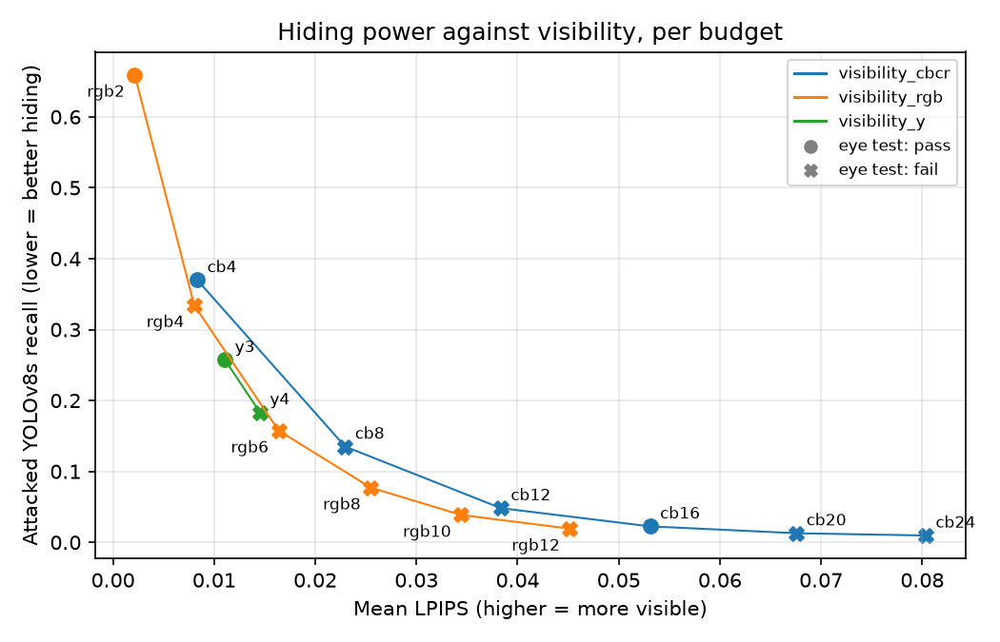

# H2: chroma noise against RGB noise

Runs: `m1_h1_main` (YCbCr) and `m1_h1_rgb` (RGB), same test images.
95% bootstrap CIs: over images for recall (shared by both runs), over plates for LPIPS.

- Attacked yolov8s_s0 recall: YCbCr 0.054 [0.045, 0.065], RGB 0.081 [0.069, 0.094]
- Recall difference (YCbCr - RGB): -0.027 [-0.036, -0.019]; equivalent (CI inside +/-0.05): yes
- Mean LPIPS over 1819 plates scored in both: YCbCr 0.039 [0.037, 0.040], RGB 0.026 [0.025, 0.027]
- LPIPS difference (YCbCr - RGB): 0.012 [0.012, 0.013]; less visible: no

**H2 not supported** by its written rule (recall within 0.05 and lower LPIPS).

## Visibility rungs (evidence the rule did not name)

| Ladder | Rung | Mean LPIPS | Attacked recall | Eye test |
|---|---|---|---|---|
| visibility_cbcr | cb4 | 0.0083 | 0.370 | pass 24/40 |
| visibility_cbcr | cb8 | 0.0229 | 0.135 | fail 26/40 |
| visibility_cbcr | cb12 | 0.0384 | 0.048 | fail 26/40 |
| visibility_cbcr | cb16 | 0.0531 | 0.023 | pass 23/40 |
| visibility_cbcr | cb20 | 0.0676 | 0.013 | fail 29/40 |
| visibility_cbcr | cb24 | 0.0803 | 0.010 | fail 31/40 |
| visibility_rgb | rgb2 | 0.0021 | 0.659 | pass 20/40 |
| visibility_rgb | rgb4 | 0.0080 | 0.334 | fail 33/40 |
| visibility_rgb | rgb6 | 0.0164 | 0.158 | fail 32/40 |
| visibility_rgb | rgb8 | 0.0255 | 0.077 | fail 32/40 |
| visibility_rgb | rgb10 | 0.0344 | 0.039 | fail 30/40 |
| visibility_rgb | rgb12 | 0.0452 | 0.019 | fail 33/40 |
| visibility_y | y3 | 0.0111 | 0.257 | pass 24/40 |
| visibility_y | y4 | 0.0145 | 0.183 | fail 26/40 |

